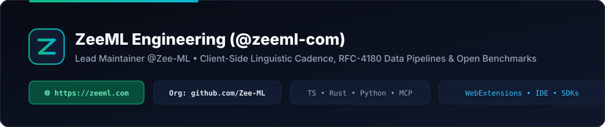

  

 

## 👋 ZeeML Core Engineering (`@zeeml-com`)

Core maintainer account for **[@Zee-ML](https://github.com/Zee-ML)** - the open-source organization behind **[ZeeML (`https://zeeml.com`)](https://zeeml.com)**.

We architect and maintain deterministic browser extensions, IDE/MCP plugins, zero-dependency language SDKs, and reproducible datasets supporting ZeeML's interactive web utilities:

### 🛠️ Featured Live Workbenches on [`zeeml.com`](https://zeeml.com)

- **Linguistic Cadence & Editorial Suite:**
  - [AI Text Humanizer (`zeeml.com/ai-humanizer`)](https://zeeml.com/ai-humanizer)
  - [AI Content & Burstiness Detector (`zeeml.com/ai-detector`)](https://zeeml.com/ai-detector)
  - [Contextual Paraphrasing Tool (`zeeml.com/paraphrasing-tool`)](https://zeeml.com/paraphrasing-tool)
  - [Grammar & Syntax Inspector (`zeeml.com/grammar-checker`)](https://zeeml.com/grammar-checker)
  - [Executive Text Summarizer (`zeeml.com/summarizer`)](https://zeeml.com/summarizer)
  - [Word Counter & Lexical Density Analyzer (`zeeml.com/word-counter`)](https://zeeml.com/word-counter)
- **Data, Document & Quantitative Suite:**
  - [JSON to CSV Relational Flattener (`zeeml.com/json-to-csv`)](https://zeeml.com/json-to-csv)
  - [PDF to Word Layout Reconstructor (`zeeml.com/pdf-to-word`)](https://zeeml.com/pdf-to-word)
  - [Global CGPA, GPA & Grading Scale Calculator (`zeeml.com/cgpa-calculator`)](https://zeeml.com/cgpa-calculator)
  - [Percentage, Margin & Delta Calculator (`zeeml.com/percentage-calculator`)](https://zeeml.com/percentage-calculator)

### 🔗 Official Links & Live Ecosystem

- **Verified GitHub Organization:** [https://github.com/Zee-ML](https://github.com/Zee-ML)
- **Official Web Platform:** [https://zeeml.com](https://zeeml.com)
- **Chrome Web Store Extension:** [ZeeML Smart Table, Grid & JSON-to-CSV Studio](https://chromewebstore.google.com/detail/zeeml-smart-table-grid-js/pdgelpgfjakiikgihmdbgngkhejlkibn)
- **Hugging Face Organization & Space:** [https://huggingface.co/zee-ml](https://huggingface.co/zee-ml)
- **All Interactive Utilities:** [https://zeeml.com/tools](https://zeeml.com/tools)
- **Engineering Methodology:** [https://zeeml.com/about](https://zeeml.com/about)
- **Developer Documentation Portal:** [https://zee-ml.github.io](https://zee-ml.github.io)
